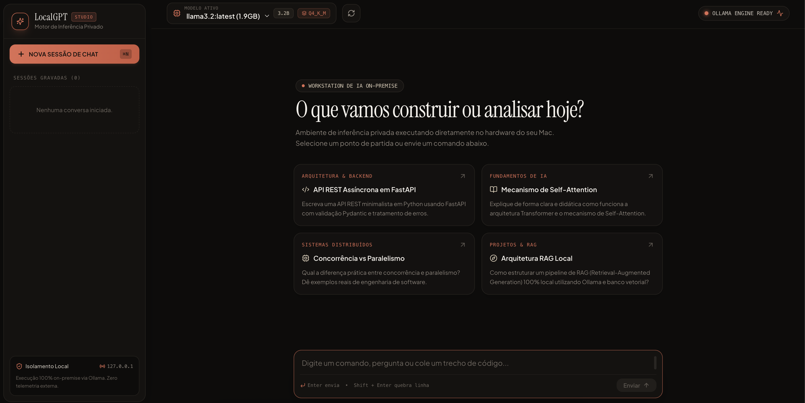
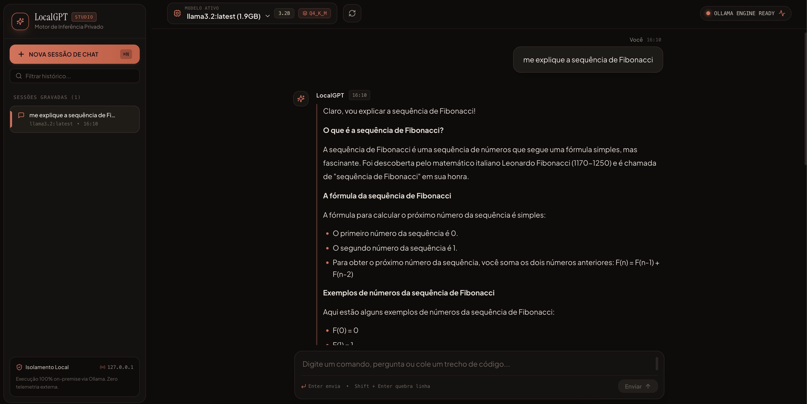

<div align="center">

# LocalGPT Studio

**Interface de Chat e Estúdio de Inferência Local para LLMs via Ollama**


</div>

---

## Sobre o Projeto

O **LocalGPT Studio** é uma aplicação web Full Stack projetada para executar e interagir com Modelos de Linguagem de Grande Escala (LLMs) **100% localmente**, utilizando o **Ollama** como motor de inferência. 

Com identidade visual autoral (*Obsidian & Terracotta Studio*), a aplicação oferece baixa latência via streaming assíncrono, total privacidade de dados (zero chamadas externas ou chaves de API pagas) e experiência de usuário voltada para desenvolvedores.

### Preview da Interface

<p align="center">
  
</p>
<p align="center">
  
</p>

---

## Principais Funcionalidades

- **Streaming Assíncrono em Tempo Real:** Recebimento de respostas token a token via protocolo `application/x-ndjson` e `ReadableStream`.
- **Controle de Inferência (`AbortController`):** Interrupção instantânea de gerações em andamento diretamente pela interface.
- **Descoberta Automática de Modelos:** Listagem dinâmica dos modelos instalados no Ollama com exibição de tamanho em disco, número de parâmetros e nível de quantização.
- **Renderização Editorial em Markdown:** Suporte completo a GFM (tabelas, listas, citações) e blocos de código estilo macOS com contador de linhas e cópia rápida.
- **Gestão de Sessões Locais:** Histórico persistente com busca instantânea de conversas, estimativa de tokens em tempo real e armazenamento isolado via `localStorage`.
- **Diagnóstico de Conexão:** Detecção automática de indisponibilidade do backend ou do servidor Ollama com instruções interativas de recuperação.

---

## Arquitetura do Sistema

```text
localgpt/
├── backend/                  # API REST & Túnel de Streaming (Python + FastAPI)
│   ├── app/
│   │   ├── main.py           # Endpoints REST (/api/status, /api/chat) e CORS
│   │   ├── ollama_service.py # Cliente assíncrono HTTPX integrado ao Ollama (:11434)
│   │   └── schemas.py        # Contratos e validação de dados (Pydantic v2)
│   └── requirements.txt
│
└── frontend/                 # Interface Reativa (React + TypeScript + Tailwind CSS)
    ├── src/
    │   ├── components/       # Sidebar, Header, ChatArea, MessageBubble, ChatInput
    │   ├── services/         # Consumo de API e decodificador de stream NDJSON
    │   └── types/            # Contratos TypeScript
    └── package.json
```

---

## Como Executar Localmente

### Pré-requisitos
- [Ollama](https://ollama.com/) instalado e em execução (`ollama serve`).
- Pelo menos um modelo baixado (ex: `ollama pull llama3.2`).
- **Python 3.10+** e **Node.js 18+**.

### 1. Clonar o repositório
```bash
git clone [https://github.com/SEU-USUARIO/localgpt.git](https://github.com/SEU-USUARIO/localgpt.git)
cd localgpt
```

### 2. Iniciar o Backend (FastAPI)
```bash
cd backend
python3 -m venv venv
source venv/bin/activate  # No Windows: venv\Scripts\activate
pip install -r requirements.txt
uvicorn app.main:app --reload --port 8000
```

### 3. Iniciar o Frontend (React + Vite)
Em um novo terminal:
```bash
cd frontend
npm install
npm run dev
```

Acesse **`http://localhost:5173`** no navegador.

---

## Licença

Distribuído sob a licença MIT.
